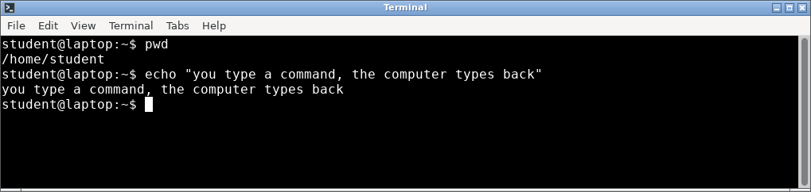

# Terminal and git

Every later step in IC101 assumes you have a way to type commands and that git is installed. This
page covers just enough of both to get you through the course, and it isn't meant as a full
tutorial on either. You'll open a terminal and install git in
[Lab 01](../labs/lab-01-terminal-and-git-overview.md).

## The terminal

A **terminal** (also called a shell, or the command line) is a text window where you type
commands instead of clicking buttons. Every operating system comes with one:

| OS | Terminal app |
|----|--------------|
| macOS | Terminal |
| Windows | Windows Terminal, or PowerShell |
| Linux | Varies by Linux distribution (distro), for example GNOME Terminal or Konsole |

When the terminal opens, it shows a **prompt**, which often ends in `$` or `>`, and waits for you
to type. When a page in this course says "run this command", it means you click into the terminal
window, type or paste the command, and press Enter.

*A shell prompt waiting for a command. The `$` marks where you type, but it isn't part of the
command, so don't type the `$` itself.*

## Git

**Git** is a tool for downloading a folder of files from a site like GitHub onto your computer
and keeping the two copies in sync. The folder is called a **repository**, or **repo**, and
copying a repo onto your computer for the first time is called **cloning** it.

In IC101 we only use git for one thing. In Lab 03 you run a single command, `git clone`, to copy
the team's shared `workspace` repo onto your laptop, and that's all the git you need for this
course.

Next: [Lab 01: Terminal and git](../labs/lab-01-terminal-and-git-overview.md).
