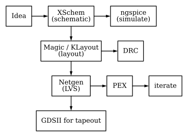
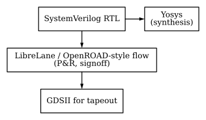

# Where each tool sits in the tapeout flow

The smoke test you just passed checked a list of tools, and this page shows where each of them
fits on the way from an idea to a chip. You won't use them to design anything in IC101; the
design work itself comes in later courses. Both flows below end at **tapeout**, the point where a
finished chip design is sent off to be manufactured. What you send to the fab is a **GDSII**
file, the format that describes the final layout.

## Analog and mixed-signal flow

{width=490 fig-alt="A flow chart in four rows. Row one: Idea, an arrow to XSchem (schematic), and an arrow from XSchem to ngspice (simulate). An arrow runs down from XSchem to row two: Magic / KLayout (layout), with an arrow to DRC. An arrow runs down from Magic / KLayout to row three: Netgen (LVS), an arrow to PEX, and an arrow from PEX to iterate. An arrow runs down from Netgen to the last row, GDSII for tapeout."}

| Tool | Stage |
|------|-------|
| XSchem | Draw and edit schematics |
| ngspice | Simulate circuits from those schematics |
| Magic / KLayout | Full-custom layout; DRC |
| Netgen | Layout vs schematic (LVS) |

## Digital flow (open-source ASIC)

{width=455 fig-alt="A flow chart in three rows. Row one: SystemVerilog RTL, with an arrow to Yosys (synthesis). An arrow runs down from SystemVerilog RTL to row two: LibreLane / OpenROAD-style flow (P&R, signoff). An arrow runs down from that box to the last row, GDSII for tapeout."}

| Tool | Stage |
|------|-------|
| Yosys | RTL → gate-level netlist |
| Verilator / cocotb | Pre-silicon verification (later courses) |
| LibreLane | Automated RTL-to-GDSII (DD103 and later) |

The early digital courses also use FPGAs, as a second path alongside the open ASIC flow. In DD102
you take a design through the open FPGA toolchain (Yosys, nextpnr and IceStorm).
That toolchain is already in the workbench image, so you won't have any vendor software to
install.

## Shared infrastructure

| Piece | Role |
|-------|------|
| Docker + IIC-OSIC-TOOLS | One environment that holds all the tools above |
| SKY130 PDK | The process design kit for the open SKY130 process |
| noVNC | Lets you reach the workbench desktop from a browser |
| `workspace` `modules/` | Each course's files, mounted into the container |

## Pick a track

This is the end of IC101. Both tracks start from here, and both assume the workbench you've just
built. You can take them in either order, or take both.

| Track | Start with | What you do first |
|---|---|---|
| Analog | [AD101: Signals](https://uoftasic.com/ad101/) | Use notes and chords to learn to read signals in time and in frequency, and to see what a filter does to them |
| Digital | [DD101: Intro to Digital Logic](https://uoftasic.com/dd101/) | Build logic circuits in browser simulators, from a single NAND gate up to a full adder |

Each track then runs in order, AD101 → AD102 → AD103 → AD104 and DD101 → DD102 → DD103 → DD104,
and the end of every course links to the next one. Every course that uses the tools reuses this
workspace. Some early courses run in a web browser instead, and for those you won't need Docker
until their labs say so.

A few links are worth keeping to hand:

- If you change the Docker tag or the PDK pin, run the smoke test again
  ([Lab 03, Part 4](../labs/lab-03-launch-the-workbench-overview.md#part-4-run-the-smoke-test)).
- When something breaks, start with [Troubleshooting](../reference/troubleshooting.md).
- Every course is listed in one place, at [edu.uoftasic.com](https://edu.uoftasic.com/).
