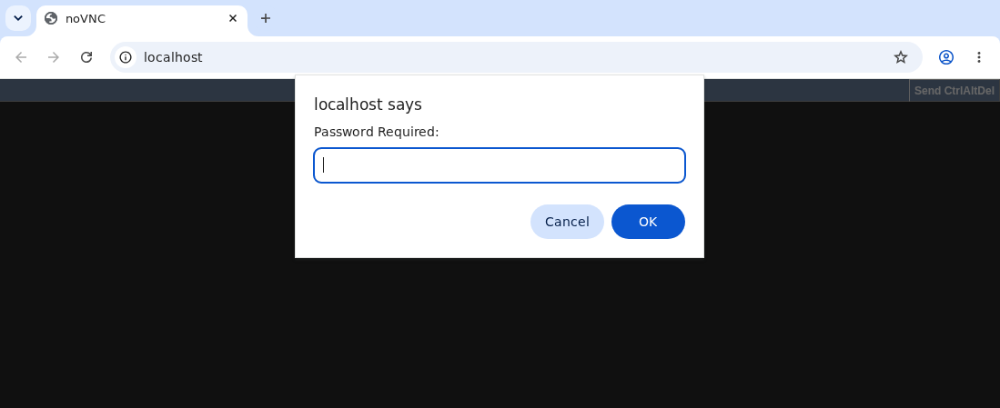

# Lab 03: Launch the workbench

You'll clone the team's `workspace` repo, start the IIC-OSIC-TOOLS container, open its desktop in
your browser, and run the smoke test. Then you'll restart the container and check which of your
files survived. When the smoke test prints `=== All checks passed ===` after that restart, your
setup is ready for every later course.

Other courses link here for their workbench setup. If one sent you, do this whole lab, then go
back to that course.

## Before you start

- You need git and Docker on your laptop. In a terminal there, run:

  ```bash
  git --version
  docker run --rm hello-world
  ```

  The first should print a version number, and the second a paragraph starting with
  `Hello from Docker!`. If git is missing, do [Lab 01](labs/lab-01-terminal-and-git-overview.md)
  first. If Docker isn't installed, do [Lab 02](labs/lab-02-install-docker-overview.md). If it's
  installed but the command fails, check that Docker Desktop shows **Engine running**, then see
  [Troubleshooting](reference/troubleshooting.md#docker-wont-start-or-hello-world-fails).
- Read [The workbench desktop](guide/launch-novnc.md) and
  [What the smoke test checks](guide/smoke-test.md).
- Have roughly 15 GB of free disk and a stable network connection. The first launch downloads an
  image of several GB.

Time: 30 minutes to 1 hour, most of it waiting for the first download.

## Part 1: Clone the workspace

1. Open a terminal on your laptop.
2. Run:

   ```bash
   git clone https://github.com/uoftasic/workspace.git
   cd workspace
   ```

   The first command creates a folder named `workspace` that holds the team's scripts and
   configuration. The second moves your terminal into that folder. Run the laptop commands in
   Parts 2 and 5 from inside it.

You should see git print `Cloning into 'workspace'...` and finish without an error. If you get
`git: command not found`, go back to [Lab 01](labs/lab-01-terminal-and-git-overview.md).

## Part 2: Start the container

1. From inside `workspace`, start the container.

   On macOS or Linux:

   ```bash
   ./scripts/start_vnc.sh
   ```

   On Windows, run it from a terminal:

   ```bat
   scripts\start_vnc.bat
   ```

   You can also double-click `scripts/start_vnc.bat` in File Explorer, but the window may close
   when the script ends, before you can read what it printed.

2. Wait for the script to finish. The first run downloads `hpretl/iic-osic-tools:2026.08` and can
   take several minutes.

You should see the script end with a block that starts `=== Open in your browser ===`, followed by
the desktop's address and password.

If the script fails because port 80 is in use, start it on another port (on macOS or Linux,
`HOST_PORT=8080 ./scripts/start_vnc.sh`) and use `http://localhost:8080/` in Part 3. Other
failures are in [Troubleshooting](reference/troubleshooting.md).

## Part 3: Open the desktop

1. In your browser, go to <http://localhost/>, or `http://localhost:<HOST_PORT>/` if you set a
   port in Part 2.

   
   *The address bar shows plain `localhost`, the default port 80. With `HOST_PORT=8080` it would
   show `localhost:8080`.*

2. Enter the password the script printed: `abc123`, unless you changed it with `VNC_PW`.

You should see a Linux desktop with a column of icons down the left, including **Terminal**,
**XSchem** and **Magic**.


*The desktop, running inside the browser tab. `Connected to ...` in the top bar means the VNC
session is live. This is the machine every later course runs on.*

If the page is blank or won't load, wait 30–60 s and reload. If it's still blank, see
[Troubleshooting](reference/troubleshooting.md#container-starts-but-the-browser-page-is-blank).

## Part 4: Run the smoke test

Every command in this part runs in a terminal inside the noVNC desktop, not on your laptop.
Inside the container, your `workspace` folder is `/foss/designs`.

1. Open **Terminal** from the icons on the left of the desktop. To paste a command from this page
   into it, press **Ctrl+Shift+V**, or use the clipboard icon in the noVNC sidebar. Plain
   `Ctrl+V` doesn't paste into the desktop.

2. Load the workspace environment:

   ```bash
   . /foss/designs/common/.designinit
   ```

   The `.` and the space after it are part of the command: they load the file into this
   terminal.

   You should see:

   ```text
   ASIC-EDU: PDK=sky130A  PDK_ROOT=/foss/pdks  designs=/foss/designs
             run 'mod' to list course modules, or 'mod <name>' to enter one.
   ```

   A new terminal on the desktop loads this file by itself, so you may already have seen these
   two lines when the terminal opened. Running it again does no harm. It's also the fix if a
   terminal ever says `bash: mod: command not found`.

3. Run the smoke test:

   ```bash
   /foss/designs/scripts/smoke_test.sh
   ```

   You should see the same two `ASIC-EDU` lines, then:

   ```text
   === ASIC-EDU workspace smoke test ===
   OK  ngspice
   OK  xschem
   OK  magic
   OK  netgen
   OK  yosys
   OK  PDK sky130A at /foss/pdks/sky130A
       ngspice-47
   --- module helpers ---
   OK  mod function loaded
   OK  add_module.sh present
   OK  mod lists ic101_setup
   OK  mod ic101_setup
   === All checks passed ===
   ```

   The indented `ngspice-47` line is the ngspice version. If any line says `FAIL` or `WARN`, see
   [Smoke test: tool or helper not found](reference/troubleshooting.md#smoke-test-tool-or-helper-not-found)
   or [Smoke test: PDK is not sky130A](reference/troubleshooting.md#smoke-test-pdk-is-not-sky130a).

4. List the course modules:

   ```bash
   mod
   ```

   You should see `Available modules:` and, under it, `ic101_setup`.

5. Go to this course's scratch folder:

   ```bash
   mod ic101_setup
   ```

   You should see `cwd: /foss/designs/modules/ic101_setup`.

## Part 5: Restart the container

Steps 4 and 5 are how you'll start the workbench at the beginning of every later session.
Before you restart it, save two test files and predict which one a restart keeps.

1. In the desktop terminal, save one file in your workspace and one in the container's `/tmp`
   folder:

   ```bash
   echo "saved in the workspace" > /foss/designs/modules/ic101_setup/restart-test.txt
   echo "saved in the container" > /tmp/restart-test.txt
   ```

2. Write down which of the two files you expect to find after you remove the container and start
   a new one.
3. In a terminal on your laptop (not the desktop), stop and remove the container. The launch
   script named it `asic-edu-osic`:

   ```bash
   docker rm -f asic-edu-osic
   ```

   It prints the name, `asic-edu-osic`, when the container is gone.
4. From inside your `workspace` folder, start the container again with `start_vnc`, as in
   Part 2. This time the image is already on your computer.
5. Reload <http://localhost/> (or your `HOST_PORT` address), enter the password, and open
   **Terminal** from the icons on the left.
6. Look for both files:

   ```bash
   cat /foss/designs/modules/ic101_setup/restart-test.txt
   cat /tmp/restart-test.txt
   ```

7. Run the smoke test again:

   ```bash
   /foss/designs/scripts/smoke_test.sh
   ```

You should see the workspace file's text, then an error for the `/tmp` file:

```text
saved in the workspace
cat: /tmp/restart-test.txt: No such file or directory
```

The smoke test should end with `=== All checks passed ===`, as in Part 4. Compare the `cat`
output with what you wrote down in step 2.

<details>
<summary>Answer</summary>

`/foss/designs` is your `workspace` folder on your laptop, mounted into the container, so the
first file is on your own disk and survives. `/tmp` exists only inside the container, and
`docker rm -f` deleted the container with everything in it. `start_vnc` also removes any old
`asic-edu-osic` container before it starts a new one, so the same happens every time you launch
the workbench. Keep your course work under `/foss/designs`.

</details>

You can leave `restart-test.txt` where it is: `ic101_setup` is this course's scratch folder.

## Finishing

You're done when, after the restart in Part 5, the smoke test ends with
`=== All checks passed ===` in a desktop terminal and `restart-test.txt` is still in
`ic101_setup`.

### Submit

Nothing to submit. Keep the `workspace` clone: every later course that uses the tools runs in it.

Next on the Course path: read [Where each tool sits in the tapeout flow](guide/tapeout-flow.md).
If another course sent you here, go back to that course's Lab 01. Courses that use the tools add
their own files to your workspace with `mod add <course>`, which
[What the smoke test checks](guide/smoke-test.md#course-modules-and-mod) describes.
