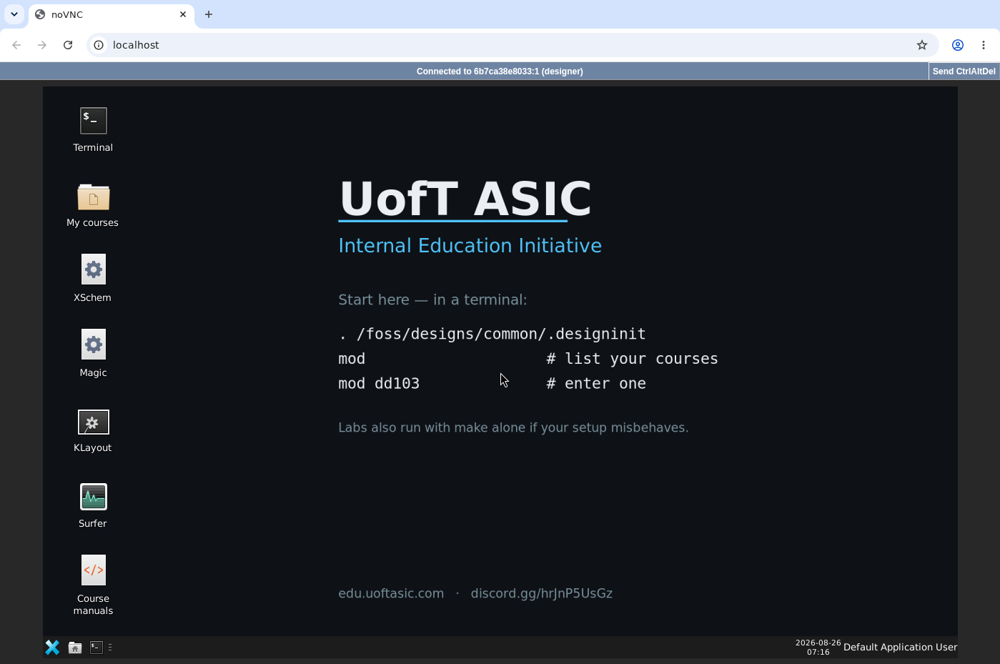

# Lab 03: Launch the workbench

You'll clone the team's `workspace` repo, start the IIC-OSIC-TOOLS container, open its desktop in
your browser, and run the smoke test. When the smoke test prints `=== All checks passed ===`, your
setup is ready for every later course.

## Before you start

- Finish [Lab 02](labs/lab-02-install-docker-overview.md): `docker run --rm hello-world` prints
  `Hello from Docker!`.
- Read [The workbench desktop](guide/launch-novnc.md) and
  [What the smoke test checks](guide/smoke-test.md).
- Make sure Docker is running: Docker Desktop shows **Engine running**, or, on Linux with Docker
  Engine, `docker run --rm hello-world` still works.
- Use a stable network connection. The first launch downloads an image of several GB.

Time: 30 minutes to 1 hour, most of it waiting for the first download.

## Part 1: Clone the workspace

1. Open a terminal on your laptop.
2. Run:

   ```bash
   git clone https://github.com/uoftasic/workspace.git
   cd workspace
   ```

   The first command creates a folder named `workspace` that holds the team's scripts and
   configuration. The second moves your terminal into that folder. Run every command in Parts 2
   and 5 from inside it.

You should see git print `Cloning into 'workspace'...` and finish without an error. If you get
`git: command not found`, go back to [Lab 01](labs/lab-01-terminal-and-git-overview.md).

## Part 2: Start the container

1. From inside `workspace`, start the container.

   On macOS or Linux:

   ```bash
   ./scripts/start_vnc.sh
   ```

   On Windows, run it from a terminal:

   ```bat
   scripts\start_vnc.bat
   ```

   You can also double-click `scripts/start_vnc.bat` in File Explorer, but the window may close
   when the script ends, before you can read what it printed.

2. Wait for the script to finish. The first run downloads `hpretl/iic-osic-tools:2026.08` and can
   take several minutes.

You should see the script end with a block that starts `=== Open in your browser ===`, followed by
the desktop's address and password.

If the script fails because port 80 is in use, start it on another port (on macOS or Linux,
`HOST_PORT=8080 ./scripts/start_vnc.sh`) and use `http://localhost:8080/` in Part 3. Other
failures are in [Troubleshooting](reference/troubleshooting.md).

## Part 3: Open the desktop

1. In your browser, go to <http://localhost/>, or `http://localhost:<HOST_PORT>/` if you set a
   port in Part 2.

   
   *The address bar shows plain `localhost`, the default port 80. With `HOST_PORT=8080` it would
   show `localhost:8080`.*

2. Enter the password `abc123`, unless you set `VNC_PW`.

You should see a Linux desktop with a column of icons down the left, including **Terminal**,
**XSchem** and **Magic**.


*The desktop, running inside the browser tab. `Connected to ...` in the top bar means the VNC
session is live. This is the machine every later course runs on.*

If the page is blank or won't load, wait 30–60 s and reload. If it's still blank, see
[Troubleshooting](reference/troubleshooting.md#container-starts-but-the-browser-page-is-blank).

## Part 4: Run the smoke test

Every command in this part runs in a terminal inside the noVNC desktop, not on your laptop.

1. Open **Terminal** from the icons on the left of the desktop. To paste a command from this page
   into it, press **Ctrl+Shift+V**, or use the clipboard icon in the noVNC sidebar. Plain
   `Ctrl+V` doesn't paste into the desktop.

2. Load the workspace environment:

   ```bash
   . /foss/designs/common/.designinit
   ```

   The `.` and the space after it are part of the command: they load the file into this
   terminal.

   You should see:

   ```text
   ASIC-EDU: PDK=sky130A  PDK_ROOT=/foss/pdks  designs=/foss/designs
             run 'mod' to list course modules, or 'mod <name>' to enter one.
   ```

3. Run the smoke test:

   ```bash
   /foss/designs/scripts/smoke_test.sh
   ```

   You should see the same two `ASIC-EDU` lines, then:

   ```text
   === ASIC-EDU workspace smoke test ===
   OK  ngspice
   OK  xschem
   OK  magic
   OK  netgen
   OK  yosys
   OK  PDK sky130A at /foss/pdks/sky130A
       ngspice-47
   --- module helpers ---
   OK  mod function loaded
   OK  add_module.sh present
   OK  mod lists ic101_setup
   OK  mod ic101_setup
   === All checks passed ===
   ```

   The indented `ngspice-47` line is the ngspice version. If any line says `FAIL` or `WARN`, see
   [Smoke test: tool or helper not found](reference/troubleshooting.md#smoke-test-tool-or-helper-not-found)
   or [Smoke test: PDK is not sky130A](reference/troubleshooting.md#smoke-test-pdk-is-not-sky130a).

4. List the course modules. `mod` only exists in a terminal where you've loaded `.designinit`,
   so in a new terminal, repeat step 2 first:

   ```bash
   mod
   ```

   You should see `Available modules:` and, under it, `ic101_setup`.

5. Go to this course's scratch folder:

   ```bash
   mod ic101_setup
   ```

   You should see `cwd: /foss/designs/modules/ic101_setup`.

## Part 5: Stop and restart the container

1. In a terminal on your laptop (not the desktop), run:

   ```bash
   docker rm -f asic-edu-osic
   ```

2. From inside your `workspace` folder, start the container again with `start_vnc`, as in
   Part 2. This time the image is already on your computer.
3. Reload <http://localhost/> (or your `HOST_PORT` address) and enter the password.

You should see the desktop again. Files under your `workspace` folder (`/foss/designs` inside the
container) live on your laptop, so removing the container doesn't touch them.

## Finishing

You're done when:

- [ ] the workspace is cloned into a folder named `workspace`
- [ ] `start_vnc` finishes without Docker errors
- [ ] the browser desktop loads and accepts the password
- [ ] you can open a terminal inside the desktop
- [ ] `smoke_test.sh` ends with `=== All checks passed ===`
- [ ] `mod ic101_setup` prints `cwd: /foss/designs/modules/ic101_setup`
- [ ] you've stopped the container with `docker rm -f asic-edu-osic` and started it again

There's nothing to submit. Keep the `workspace` clone: every later course that uses the tools runs
in it. To finish the course, read
[Where each tool sits in the tapeout flow](guide/tapeout-flow.md).
